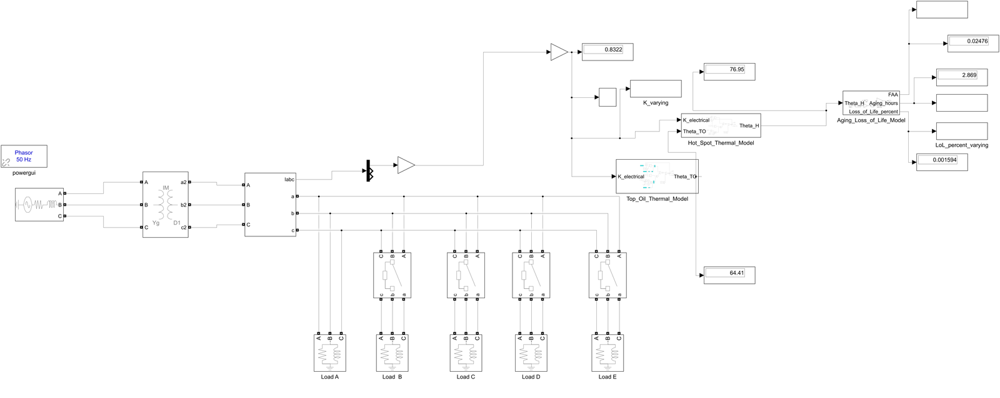
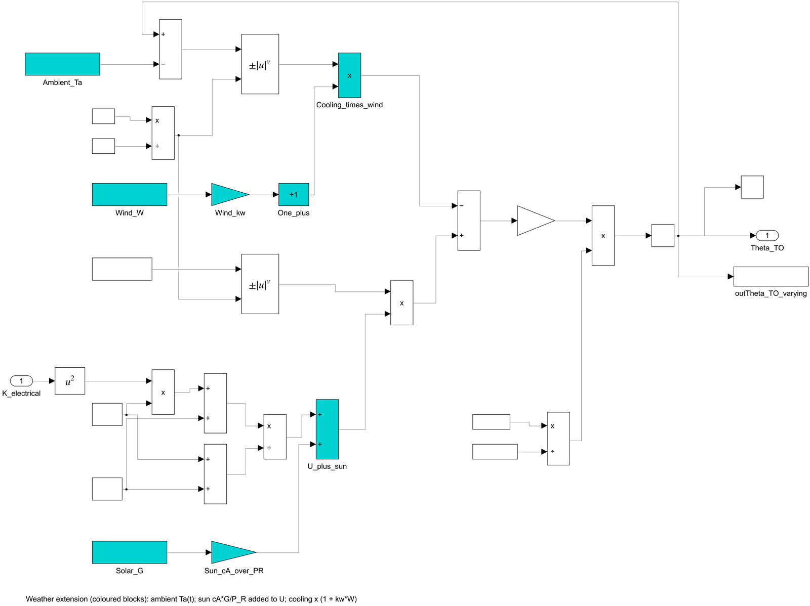
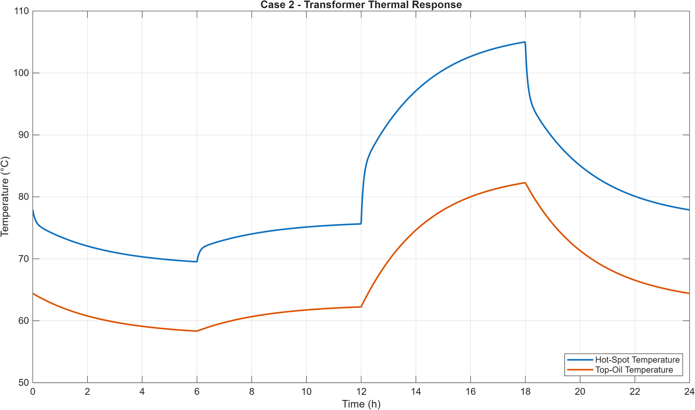
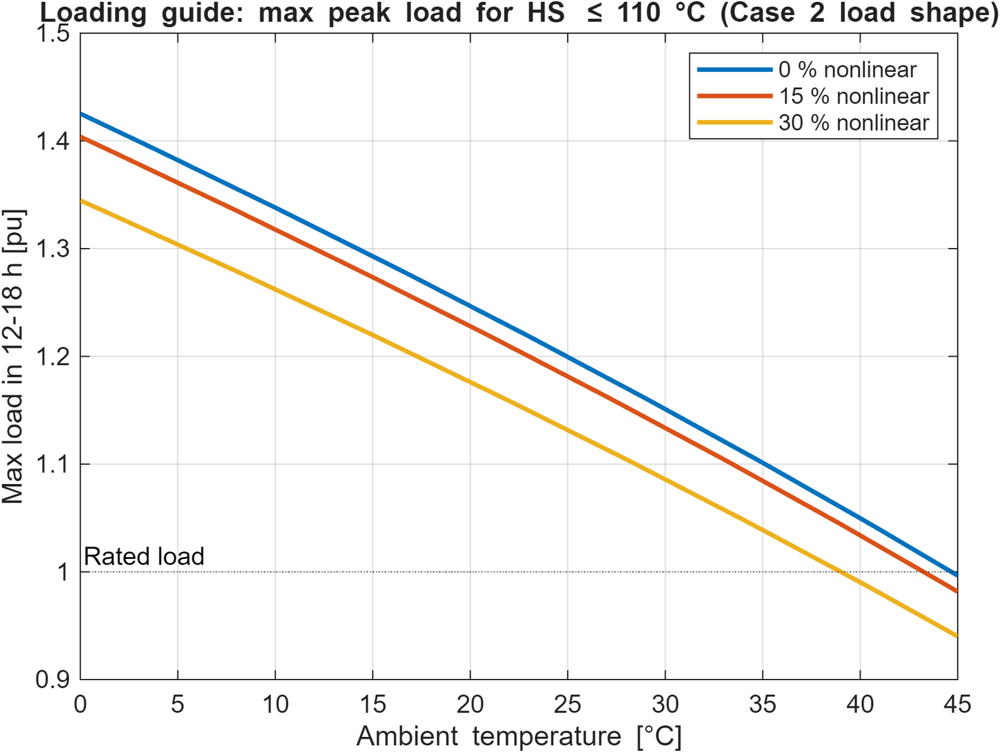
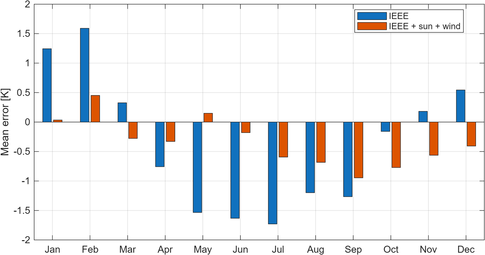
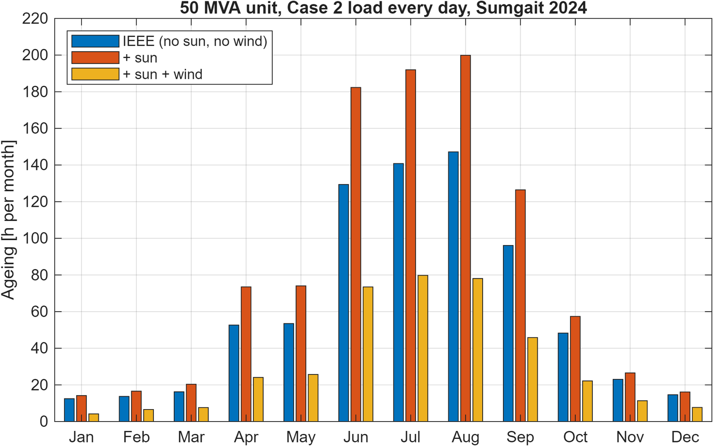
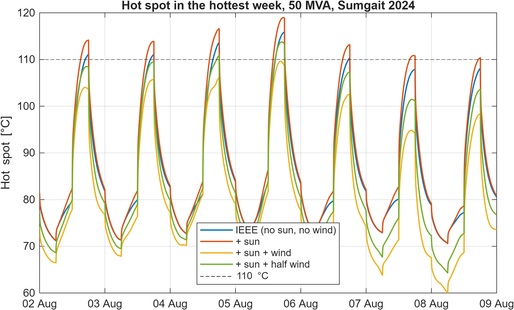

# Transformer Thermal Aging under Overloading, Harmonics, Sun and Wind

MATLAB/Simulink model of a **50 MVA, 110/10.5 kV ONAN oil-immersed power transformer** at an industrial plant on the Caspian coast (Sumgait, Azerbaijan). The model calculates the **top-oil and hot-spot temperatures** and the **insulation aging** under cyclic overloading, harmonic (nonlinear) loads and real outdoor weather.

The standard IEEE C57.91 thermal model takes the weather into account only through the ambient temperature. This work extends its top-oil equation with two terms, **solar heating** and **wind cooling**. It identifies them from an open measured dataset and applies them to the plant transformer with one year of local weather.

> MS in Electrical and Computer Engineering thesis, ADA University – The George Washington University (joint program), 2026.
> Author: **Mahammad Gubadli** · Supervisor: **Burcu Ramazanli**

---

## Motivation

Transformers are often overloaded for a few hours a day, and more and more of their load is nonlinear (rectifiers, drives). Both raise the **hot-spot temperature**, which sets how fast the paper insulation ages and so how long the transformer lives. Engineers usually check this with the IEEE C57.91 thermal model.

An outdoor transformer, however, is also **heated by the sun** and **cooled by the wind**. The standard model ignores both effects. At a sunny but windy coastal site, the two effects work in opposite directions. The question is which one wins, and how much it changes the loading limits.

## Model



The integrated Simulink model has two parts:

1. **Electrical part (Simscape Electrical):** a 110 kV grid, the 50 MVA two-winding transformer, a V-I measurement and five plant loads (A–E) switched on a daily schedule. The measured LV current gives the per-unit load **K(t)**.
2. **Thermal chain:**
   - **Top-oil subsystem:** IEEE C57.91 Annex G (exponential form), extended for sun and wind.
   - **Hot-spot subsystem:** the hot-spot gradient above the top oil.
   - **Aging subsystem:** the aging acceleration factor F_AA, the equivalent aging hours and the loss of life.

The thermal sub-models follow Aslam et al. (2021). The time constants are corrected so that they keep their IEEE meaning.

**Top-oil equation with the weather extension.** The extension blocks are cyan in the figure below.

```
dΘ_TO/dt = (ΔΘ_TO,R / τ_TO) · [ U + cA·G / P_R  −  (1 + k_w·W) · ((Θ_TO − Θ_A) / ΔΘ_TO,R)^(1/n) ]
U = (K²·R + 1) / (R + 1)
```

| Symbol | Meaning |
|---|---|
| G | global horizontal solar irradiance [W/m²] |
| W | wind speed at 10 m [m/s] |
| cA | effective sunlit area × absorptivity [m²] |
| k_w | wind cooling factor [1/(m/s)] |

- With **G = 0 and W = 0**, the equation becomes the standard IEEE model exactly. This is checked in the code; the difference is 0.0000 K.
- Harmonics enter through the harmonic loss factor (IEEE C57.110).



## Studies and key results

### 1. Case studies (`1_Case_studies/`)

| Study | What changes |
|---|---|
| Case 1 | rated cyclic daily load |
| Case 2 | moderate overload, 1.16 pu from 12:00 to 18:00 (reference case) |
| Case 3 | Case 2 plus a 30-minute overload at 1.6 pu |
| SA1 | ambient temperature, swept continuously from 0 to 45 °C |
| SA2 | harmonics: a rectifier load, and a nonlinear share from 0 to 50 % |

- **Reference case:** Case 2 at 24 °C gives a peak hot spot of 105.0 °C, a peak top oil of 82.3 °C and 2.71 h of aging per day. Each run repeats the day until it ends where it started (periodic steady state).



- **Ambient:** the peak hot spot rises exactly 1 K for every 1 °C of ambient. Case 2 reaches the 110 °C limit at an ambient of **29 °C**, and daily aging doubles about every 6.3 °C.
- **Harmonics:** below about 15 % nonlinear share they add less than 2 K. At 30 % they add about 7 K, and at 50 % about 20 K. Case 2 crosses 110 °C at a **25 % share** (at 24 °C ambient).
- **Which dominates:** under realistic plant conditions, the **ambient temperature** has the bigger effect. Harmonics matter most on hot afternoons, when the transformer is already near its limit.
- **Loading guide (datasheet):** the maximum allowed peak load for a hot spot ≤ 110 °C, depending on the ambient temperature and the nonlinear share. It is in `1_Case_studies/Datasheet_50MVA.xlsx`.



### 2. Check against measured data (`2_Norway_validation/`)

- **Dataset:** one year of hourly load, ambient and top-oil measurements from a 40 MVA ONAN transformer in Norway (Bærug et al., 2025).
- **Method:** the parameters are fitted on January–June and tested on July–December, data the model has not seen.
- **Simulink vs equation:** the top-oil Simulink model reproduces its equation to **0.013 K**.
- **Model vs measurement:** the error (RMSE) is **1.70 K**.
- **Limits:** only the top oil is checked, and only up to 0.43 pu load.

### 3. Weather extension (`3_Weather_extension/`)

**Identification on the Norway data, with Open-Meteo weather for the site:**

| Model | cA [m²] | k_w [1/(m/s)] | RMSE, test half-year [K] |
|---|---|---|---|
| IEEE (standard) | – | – | 1.55 |
| + sun + wind | 20.1 | 0.050 | **1.10** (−29 %) |

The extension removes the seasonal error of the standard model: the standard model runs too cold in summer and too warm in winter.



**Application to the 50 MVA plant transformer:** the Case 2 load is applied every day, with Sumgait weather for 2024 and cA scaled to 22.5 m².

| Model | Aging [h/yr] | Max hot spot [°C] | Days above 110 °C |
|---|---|---|---|
| IEEE (standard) | 748 | 115.9 | 52 |
| + sun | 999 (+34 %) | 119.0 | 96 |
| **+ sun + wind** | **386 (−48 %)** | **109.6** | **0** |
| + sun + half wind | 587 (−21 %) | 113.8 | 15 |



**Main finding:** at this windy coastal site, wind cooling outweighs solar heating. The standard IEEE model **overestimates the annual insulation aging by about 21–48 %**, and it predicts that the hot spot exceeds 110 °C on 52 days a year. With sun and wind included, it never exceeds 110 °C.



---

## How to run

**Requirements:** MATLAB R2025a or newer, Simulink and Simscape Electrical.

You don't need to open any Simulink model by hand. Each study is started from **one MATLAB script**. The script loads the parameters, runs the models in the background, and saves the results and figures.

1. Download the repository (**Code → Download ZIP**) and unzip it.
2. In MATLAB, open the script for the study you want and press **Run**. If MATLAB asks, choose **Change Folder**.

| Folder | Start script | What it does |
|---|---|---|
| `1_Case_studies/` | `run_all_cases.m` | Cases 1–3, SA1 (discrete), SA2; 22 figures and the result tables |
| `1_Case_studies/` | `step12_ambient_vs_harmonics_datasheet.m` | ambient vs harmonics comparison and the loading datasheet |
| `1_Case_studies/` | `SA2_1_rectifier_spectrum.m` | six-pulse rectifier harmonic spectrum (input for SA2) |
| `2_Norway_validation/` | `run_Validation.m` | IEEE top-oil model vs the measured Norway data |
| `3_Weather_extension/` | `step6_weather_extension.m` | fits the sun and wind parameters on the Norway data |
| `3_Weather_extension/` | `step9_extend_thesis_model.m` | adds the sun and wind blocks to the thesis Simulink model and checks it |
| `3_Weather_extension/` | `step10_SA1_continuous.m` | SA1 with a continuous ambient sweep, 0–45 °C |
| `3_Weather_extension/` | `step11_sumgait_year_simulink.m` | full Sumgait year on the Simulink model (about 12 min) |

Each folder is self-contained: its scripts only read files from the same folder.

### How the scripts connect to the Simulink models

- `Case2_inputs.m` puts every parameter into the MATLAB workspace: the nameplate data, the IEEE constants and the time constants. The Simulink blocks read these variables by name, for example `THETA_O_R`, `Tt_O` and `n`.
- The `run_*` and `step*` scripts change one variable at a time (ambient, harmonic share, weather inputs). They call `sim()` on the model and collect the outputs.
- Weather time series reach the model through **From Workspace** blocks: `Ta_ws` (ambient), `G_ws` (sun) and `W_ws` (wind).
- **Scripts that check the model:**
  - `step7_sumgait_year.m` solves the same equations as a plain script, as a cross-check of the Simulink results.
  - `step8_simulink_sunwind.m` is a stand-alone test model.
  - `tidy_*` and `layout_*` only rearrange the block diagrams; they don't change any equation.

## Repository structure

```
1_Case_studies/        Case 1–3, SA1, SA2, datasheet (models, scripts, results, figures/)
2_Norway_validation/   top-oil model vs measured data (40 MVA, Norway)
3_Weather_extension/   sun + wind extension: fit, thesis model, Sumgait year
docs/figures/          figures used in this README
docs/block_diagrams/   block diagrams of the Simulink models (SVG)
Thesis_results_5Nov.xlsx  result tables of the case studies
```

## Data sources

- **Measured transformer data:** Bærug, H., Madshaven, I., & Espedal, C. (2025). *Supporting data for thermomechanical modelling of clamping force in power transformer in operation* (v1.0) [Data set]. Zenodo. https://doi.org/10.5281/zenodo.17223516. Licensed under CC BY 4.0. The file `Barug2025_sensordata.csv` is included unchanged.
- **Weather data:** hourly historical weather from [Open-Meteo](https://open-meteo.com/), for Oslo and Sumgait in 2024. Licensed under CC BY 4.0.
- **Case-study transformer:** 50 MVA, 110/10.5 kV, YNd5, ONAN (nameplate data). The thermal constants come from IEEE C57.91 and Aslam et al. (2021).

## References

- IEEE Std C57.91, *IEEE Guide for Loading Mineral-Oil-Immersed Transformers and Step-Voltage Regulators*.
- IEEE Std C57.110-2018, *IEEE Recommended Practice for Establishing Liquid-Immersed and Dry-Type Power and Distribution Transformer Capability When Supplying Nonsinusoidal Load Currents*.
- Aslam, M., et al. (2021). *IEEE Access*, 9, 71461. https://doi.org/10.1109/ACCESS.2021.3078759
- Swift, G., Molinski, T. S., & Lehn, W. (2001). A fundamental approach to transformer thermal modeling. *IEEE Transactions on Power Delivery*.

## License

The code is released under the MIT License (see `LICENSE`). The datasets keep their original licenses, listed above.
